  

  

  

  

  

### 🚀 Featured builds

<!-- FEATURED:START -->
| Project | What it is | Stack | ★ |
|:--|:--|:--|:-:|
| [**suryakantarora.github.io**](https://github.com/suryakantarora/suryakantarora.github.io) | My Profile | `HTML` `CSS` `JavaScript` | 2 |
| [**portfolio-3d**](https://github.com/suryakantarora/portfolio-3d) | 3d portfolio website | `JavaScript` `CSS` `HTML` | 1 |
| [**library-assignment**](https://github.com/suryakantarora/library-assignment) | A small library assignment using angular and java spring boot | `Java` `TypeScript` `CSS` | 0 |
<!-- FEATURED:END -->

  <a href="https://github.com/suryakantarora?tab=repositories">See all repositories →</a>

 

### 🏙️ Contribution skyline

  

  <picture>
    <source media="(prefers-color-scheme: dark)" srcset="https://raw.githubusercontent.com/suryakantarora/suryakantarora/output/github-contribution-grid-snake-dark.svg" />
    
  </picture>

 

  

  
  

 

  Designed for clarity · Built for scale · Cards regenerate daily from live GitHub data

