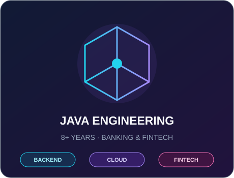

 

### TECHNICAL LEAD · JAVA ECOSYSTEM · DISTRIBUTED SYSTEMS

*Engineering reliable financial platforms, scalable services, and meaningful digital experiences.*

---

## `01` / SYSTEM PROFILE

<table>
<tr>
<td width="58%" valign="top">

### Hello, I'm Suryakant 👋

I'm a **Technical Lead and Java Engineer** with 8+ years of experience building enterprise applications, banking solutions, payment systems, and distributed services.

- **Core engineering:** Java, Spring Boot, Quarkus
- **Architecture:** Microservices, REST APIs, event-driven systems
- **Data & messaging:** PostgreSQL, MongoDB, Redis, Kafka
- **Frontend & mobile:** Angular, Flutter
- **Domain:** Banking, payments, settlement and reconciliation

I enjoy turning complex requirements into secure, maintainable, production-ready systems.

</td>
<td width="42%" valign="top" align="center">

</td>
</tr>
</table>

## `02` / TECHNOLOGY MATRIX

<b>View engineering focus</b>

| Area | Technologies |
|---|---|
| Backend | Java 8/17/21, Spring Boot, Quarkus, JPA, Hibernate |
| Architecture | Microservices, API Gateway, OAuth2, JWT, Resilience4j |
| Data | PostgreSQL, Oracle, SQL Server, MongoDB, Redis, Hazelcast |
| Messaging | Kafka, RabbitMQ |
| Frontend | Angular, TypeScript, HTML, CSS |
| Mobile | Flutter, Ionic, Capacitor |
| Delivery | Docker, Kubernetes, GitHub Actions, Azure DevOps |

## `03` / GITHUB TELEMETRY

  
  

  

## `04` / CONTRIBUTION FLOW

  

## `05` / FEATURED ENGINEERING

<table>
<tr>
<td width="50%" valign="top">

### Banking & Payments
Secure APIs, payment processing, debit-card settlement and reconciliation workflows.

</td>
<td width="50%" valign="top">

### Distributed Services
Microservices, asynchronous processing, caching, resilience and scalable integrations.

</td>
</tr>
<tr>
<td width="50%" valign="top">

### Enterprise Platforms
Role-based portals, workflow automation, reporting and multi-module business applications.

</td>
<td width="50%" valign="top">

### Product Engineering
End-to-end delivery across backend services, web interfaces and mobile applications.

</td>
</tr>
</table>

**Public repositories to explore**

- [Personal website — suryakantarora.github.io](https://github.com/suryakantarora/suryakantarora.github.io)
- [GitHub profile configuration](https://github.com/suryakantarora/suryakantarora)
- [README template](https://github.com/suryakantarora/Best-README-Template)

Add your strongest production-safe demos and project repositories here as you choose them.

## `06` / CURRENT TRANSMISSION

  
    
  **Open to connecting with engineers, architects and teams building reliable software.**
   
  <a href="https://github.com/suryakantarora">Explore my GitHub ↗</a> · <a href="https://suryakantarora.com">Portfolio ↗</a>

---

  Designed with precision · Built with curiosity · Powered by coffee and clean code
   
  Last profile update: maintained through GitHub

