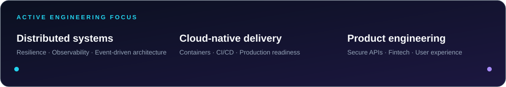

  

  
  

 

## `01` / SYSTEM PROFILE

<table>
<tr>
<td width="64%" valign="top">

### Hello, I'm Suryakant 👋

**Technical Lead & Java Engineer** with 8+ years of experience building enterprise platforms, banking systems, payment workflows and distributed services.

I turn complex requirements into secure, maintainable and production-ready software.

 

**FOCUS**

- `Architecture` — Microservices, APIs, event-driven systems
- `Platform` — Java, Spring Boot, Quarkus
- `Data` — PostgreSQL, MongoDB, Redis
- `Delivery` — Docker, Kubernetes, CI/CD

</td>
<td width="36%" valign="middle" align="center">

</td>
</tr>
</table>

## `02` / TECHNOLOGY MATRIX

  

 

<table>
<tr>
<td align="center"><b>BACKEND</b> Java · Spring · Quarkus</td>
<td align="center"><b>ARCHITECTURE</b> REST · Microservices · OAuth2</td>
<td align="center"><b>DATA</b> PostgreSQL · MongoDB · Redis</td>
</tr>
<tr>
<td align="center"><b>MESSAGING</b> Kafka · RabbitMQ</td>
<td align="center"><b>CLOUD DELIVERY</b> Docker · Kubernetes · CI/CD</td>
<td align="center"><b>PRODUCT</b> Angular · Flutter · TypeScript</td>
</tr>
</table>

## `03` / GITHUB TELEMETRY

  
  

  

  

## `04` / CONTRIBUTION FLOW

  <picture>
    <source media="(prefers-color-scheme: dark)" srcset="https://raw.githubusercontent.com/suryakantarora/suryakantarora/output/github-contribution-grid-snake-dark.svg" />
    
  </picture>

## `05` / ENGINEERING SIGNALS

<table>
<tr>
<td width="50%" valign="top">

### Banking & Payments
Secure APIs, card settlement, reconciliation and financial workflow automation.

</td>
<td width="50%" valign="top">

### Distributed Systems
Microservices, asynchronous processing, caching, resilience and observability.

</td>
</tr>
<tr>
<td width="50%" valign="top">

### Enterprise Platforms
Role-based applications, workflow orchestration and reporting systems.

</td>
<td width="50%" valign="top">

### Product Engineering
End-to-end delivery across backend services, web applications and mobile experiences.

</td>
</tr>
</table>

## `06` / ACTIVE TRANSMISSION

  

 

  <b>Open to conversations with engineers and teams building reliable, impactful software.</b>
    
  <a href="https://github.com/suryakantarora">Explore GitHub ↗</a>
  &nbsp;·&nbsp;
  <a href="https://suryakantarora.com">Visit Portfolio ↗</a>

---

  Designed for clarity · Built for scale · Powered by curiosity and clean code

